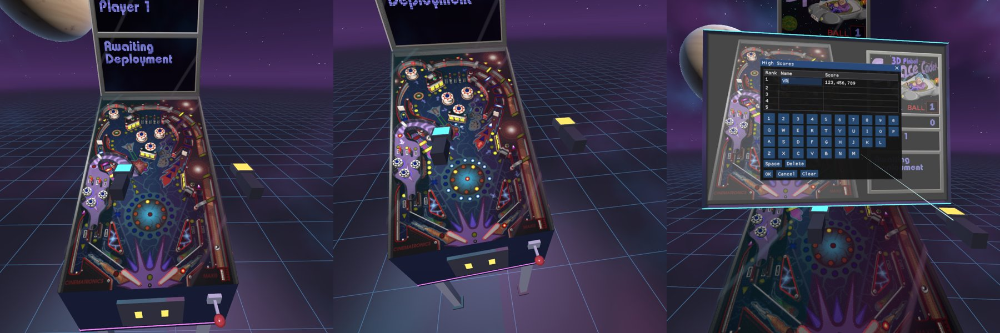

# Space Cadet Pinball VR

*3D Pinball for Windows – Space Cadet* in virtual reality, made for the **Steam Frame** and any
OpenXR headset on Linux.



The original game runs unchanged inside a 3D arcade. Its table is laid flat on a pinball cabinet with
real perspective, and the score panel sits on the backbox. You play with your VR controllers: flick the
triggers for the flippers, or reach out and press the buttons on the side of the cabinet and pull back
the plunger.

Based on the [SpaceCadetPinball](https://github.com/k4zmu2a/SpaceCadetPinball) decompilation by
Andrey Muzychenko (k4zmu2a).

## Features

- **Cabinet view:** the table art is pre-rendered in perspective, so it is un-projected with the game's
  own camera onto a flat playfield and VR supplies the perspective. The metal frames painted in the art
  are the machine's frame.
- **Theater view:** the whole game on one big screen.
- **Physical controls:** flipper buttons on both sides of the cabinet and a plunger you pull back by
  hand; the launch strength follows how far you pull.
- **Controller feedback:** rumble for flippers, bumpers, kickers, the plunger and tilt; nudging shakes
  the cabinet.
- **Menus in VR:** the game's menus and dialogs appear on a floating panel you point at with either
  controller, with an on-screen keyboard for high-score names.
- **Movable table:** while paused, grab with both hands to move and turn the table or screen.
- Native Linux ARM64 build for the Steam Frame, and x86_64 for Linux PCs with SteamVR.

## Game data

The original game files are not included. You need them from a copy of *3D Pinball for Windows –
Space Cadet* (Windows XP and earlier). The *Full Tilt! Pinball* `CADET.DAT` version also works.

Put them in the `assets` folder of the package:

```
SpaceCadetPinball-VR-linux-arm64/
├── SpaceCadetPinball
├── run-vr.sh
├── lib/
└── assets/      <- PINBALL.DAT, FONT.DAT, table.bmp, *.WAV, PINBALL2.MID
```

## Installing on the Steam Frame

Download `SpaceCadetPinball-VR-linux-arm64.tar.gz` from the
[releases](../../releases) (or from a build's **Artifacts** under Actions), unpack it and add the game
files to `assets`.

1. **On the headset:** Steam Settings → System → turn on **Enable Developer Mode**, then in the
   Developer section choose **Set User Password**.
2. **On your PC:** install the **SteamOS Devkit Client** from Steam (`steam://install/943760`).
3. **Pair:** on the headset choose Settings → Developer → **Pair new host**; in the Devkit Client's
   Devkits tab click **Register** (or connect by IP to `frame`).
4. **Title Upload** in the Devkit Client:
   - Name: `Space Cadet Pinball VR`
   - Local Folder: the unpacked `SpaceCadetPinball-VR-linux-arm64` folder
   - Start Command: `run-vr.sh`
   - Runtime: **Steam Linux Runtime 3.0 ARM64 (Sniper)**
5. **Upload**, then **Start**. Afterwards it is in the headset's library under
   **Non-Steam → Devkit Game: Space Cadet Pinball VR**.

### Linux PC with SteamVR

Use `SpaceCadetPinball-VR-linux-x86_64.tar.gz`, add the game files to `assets`, start SteamVR and run
`./run-vr.sh`. This also works for streaming to the Frame from a Linux PC.

Windows and macOS are not supported by this fork.

## Controls

Bindings are included for the Steam Frame controller, Quest Touch, Valve Index, HTC Vive and the
generic OpenXR controller. They can be changed in SteamVR's controller bindings.

| Action | Steam Frame | Touch-style controllers |
|---|---|---|
| Flippers | Left / right trigger or bumper | Left / right trigger |
| Flipper buttons on the cabinet | Reach to the cabinet's side and squeeze the grip | same |
| Plunger knob | Grip the knob, pull back, let go | same |
| Plunger (button) | Hold A, release to launch | Hold A |
| Nudge left / right / up | Left stick flick or D-pad | Left stick flick |
| Pause | B | B |
| New game | Hold X | Hold X (left) |
| Cabinet / theater view | Y | Y (left) |
| Move table nearer / further | Right stick up / down | Right stick |
| Playfield tilt (theater: screen size) | Right stick left / right | Right stick |
| Recenter | Click right stick | Click right stick |
| Menu (pauses the game) | View or Menu button | Menu (left) |
| Close menu | D-pad down or Menu again | Click left stick or Menu |
| Move / turn the table (paused or in a menu) | Hold both grips and move your hands | same |

In menus, point with either controller and pull its trigger to click. The **VR** menu has sliders for
the playfield tilt, distance, height and table size, and a controls reference. Settings are saved with
the game's other options.

## Troubleshooting

The launcher writes everything the game prints to `last-run.log` next to `run-vr.sh`. On the Steam
Frame, connect with `ssh steamos@frame` (using the password you set) and look in
`~/devkit-game/<name you uploaded it as>/last-run.log`.

| Problem | What to check |
|---|---|
| "The .dat file is missing" | The game files must be in the `assets` folder. |
| "Could not start VR (OpenXR)" | On a PC, start SteamVR first. |
| Table in the wrong place | Click the right stick to recenter, or pause and grab with both hands. |
| No music | MIDI music needs instrument patches that SteamOS doesn't have; sound effects still work. Music is off by default. |

## Building and contributing

See [Doc/BUILDING.md](Doc/BUILDING.md) for building, the GitHub Actions packages, how the VR mode works
and testing without a headset, and [CONTRIBUTING.md](CONTRIBUTING.md) for reporting issues and sending
changes.

## Licence

MIT, see [LICENSE](LICENSE). Bundled third-party components are listed in
[Platform/SteamFrame/THIRD_PARTY.txt](Platform/SteamFrame/THIRD_PARTY.txt). *3D Pinball for Windows –
Space Cadet* and its game data belong to their respective owners and are not part of this project.
